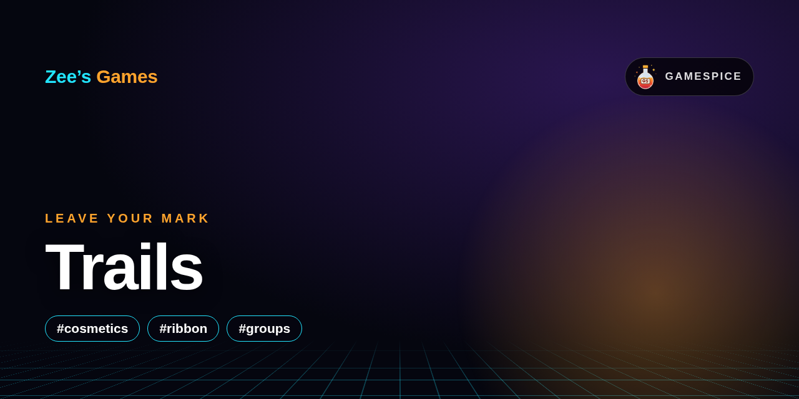

[](https://moddingcommunity.com/a/119-gs-trails)

Players equip a trail, an image ribbon that follows them as they move. Operators upload trails and choose who may wear them: everyone, or only some groups (donators, say). The server decides what a player may wear, and clients download every trail as one pack before joining. Design notes: [docs/design.md](docs/design.md).

**Licensing: this addon provides upload and display only. It ships no art; whoever uploads an image is responsible for having the right to distribute it.**

## Install

1. Get [Godot 4.7](https://godotengine.org/download).
2. Either use [dot-bootstrap](https://github.com/gamespice-platform/bootstrap), which clones every project and links the addons, or copy `addons/dot_trail/` and its dependencies into your project and enable dot-trail in *Project > Project Settings > Plugins*.

## Use

```gdscript
var trails := DotTrailRegistry.new()
trails.install()                                   # DotRegistry, no autoload
trails.load_index(index_json, files)               # the downloaded pack
var equip := DotTrailEquip.new(trails)
var res := equip.equip(peer_id, "spark", groups, entitlements)   # DotResult; server only

var emitter := DotTrailEmitter.new()               # child of the player, or set `target`
emitter.registry = trails
player.add_child(emitter)
emitter.set_trail(trails.get_def(equip.worn(peer_id)))
```

## Settings

`DotTrailConfig`, layered as file, then `DOT_TRAIL_*` environment, then `--trail-*` command line.

| Setting | Default | Meaning |
| --- | --- | --- |
| `enabled` | true | Trails on or off. |
| `min_step` | 0.15 | Distance moved before a new ribbon point. |
| `max_points` | 64 | Points kept per ribbon, which sets its length. Any value; 0 is unlimited (lifetime alone bounds it). 1 is refused. |
| `equip_cooldown` | 1.0 | Seconds between equip changes. |
| `max_trails` | 256 | Trails the registry accepts. Any value; 0 is unlimited. |
| `max_upload_bytes` | 262144 | Largest uploaded image. Any value; 0 is unlimited. |
| `max_dimension` | 512 | Largest image side in pixels. Any value; 0 is unlimited. |
| `max_width` | 2.0 | Widest ribbon a trail may ask for, in metres. Any value; 0 is unlimited. |
| `max_lifetime` | 5.0 | Longest ribbon lifetime a trail may ask for, in seconds. Any value; 0 is unlimited. |
| `cull_distance` | 60 | Distance beyond which a ribbon is not drawn. 0 is never culled. |

These are limits you can change, and like other GameSpice settings 0 means unlimited. A negative value is refused when the config is validated, never clamped.

## Testing

Import the project once, then run `trail_selftest.tscn`, `ui_selftest.tscn` and `http_selftest.tscn` (the site routes against a mocked HTTP layer) in `examples/` headless with Godot.

## Credits

| Item | Source |
| --- | --- |
| Trail art | None shipped. Every trail carries a `credit` (author, licence and source URL), required by the upload form and shown in the store. |
| Store page, ribbon previews, screenshots in `docs/` | Drawn by the addon's own code from generated noise and flat colours. No third-party image is bundled. |
| Engine and addons | Godot Engine (MIT) and the dot-core, dot-game, dot-net, dot-menu, dot-ui and dot-cloud addons of this family. |
| Site routes | The TMC site's trail routes: `/api/app/v1/trails` for players and `/api/integration/v1/trails` for the game server. |

## Status and licence

Part of the [**GameSpice**](https://gamespice.net) platform of Godot addons. Written with Claude Code and maintained by `gamemann`. Every addon has headless tests, but little of this has been played by real users yet, so expect rough edges and please [open an issue](https://github.com/zees-games/dot-trail/issues) when you hit one.

MIT licence, see [LICENSE](LICENSE). The only closed part of the [**GameSpice**](https://gamespice.net) platform is the web back end; you can use your own instead of GameSpice's.
