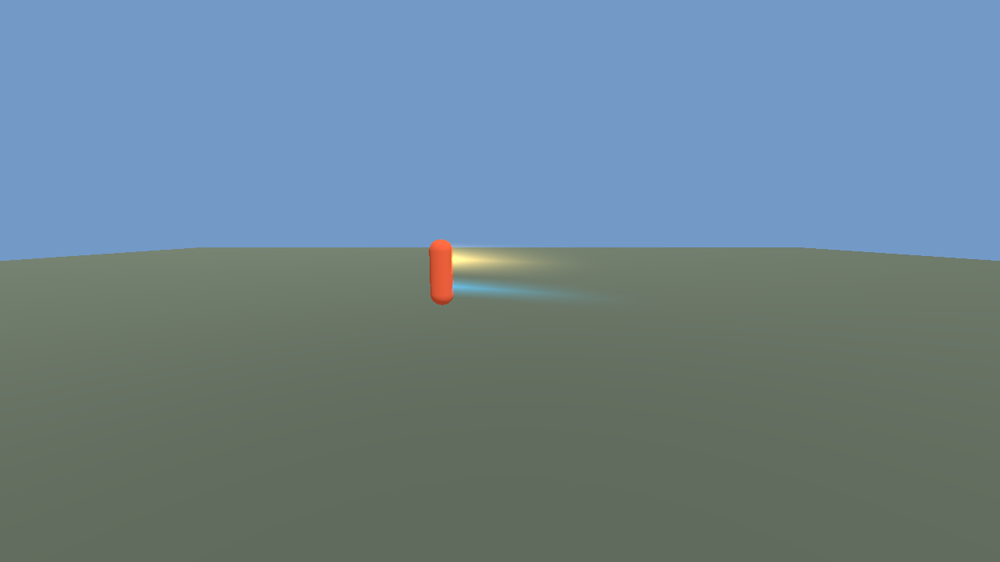
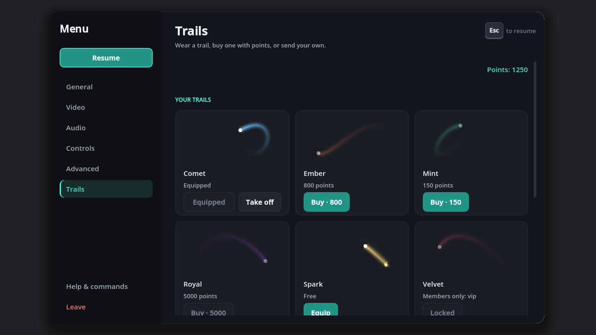

# dot-trail design

## What it is

A trail is an image that follows a player as they move. Operators upload trails, choose who may wear them, and every client downloads the whole set as one pack before joining. Players equip one; the server decides whether they may. The addon is game-agnostic: it attaches to any node through a `DotNodeRef`.

## Reuse map

| Need | Already exists | New here |
| --- | --- | --- |
| Pack delivery to clients | dot-cloud: signed manifest, content-addressed cache, mount before join. A trail set is one pack whose files are images plus `trails.json`; `DotTrailRegistry.to_index()` writes the index and lists the files | the index format, nothing about download |
| Operator upload UI and identity | dot-workbench (`DotWorkbenchIdentity`, panel, publish). Trails are a profile section, like wearables | `DotTrailUpload.validate()`, a pure function the workbench form calls |
| Groups and permissions | dot-user profile and scope carry the player's groups; the server passes the group list in | `access` field on a def and `DotTrailRegistry.may_equip()` |
| Owning something | dot-inventory for item ownership, dot-economy sells ids and grants nothing | trails are ids; a purchase is an entitlement list the backend returns, handed to `DotTrailEquip` |
| Particles and decals | dot-fx, dot-effects | not used: a ribbon is one mesh per wearer, cheaper than a particle system and identical headless |
| Config, logging, errors | dot-core `DotConfig`, `DotLog`, `DotResult`, `DotRegistry`, `DotNodeRef` | cvars, channel `trail` |

## Data model: `DotTrailDef`

| Field | Meaning |
| --- | --- |
| `id` | `[a-z0-9_]{1,32}`, unique, the only thing sent over the wire |
| `title` | shown in menus and the store |
| `image` | file name inside the pack (`png` or `webp`) |
| `width` | ribbon width in metres |
| `lifetime` | seconds a point of the ribbon lives |
| `color` | modulate, multiplied with the image |
| `blend` | `mix`, `add` or `mul` |
| `access` | `public`, or `groups` with `groups: [..]` (any one is enough) |
| `price` | store points; 0 is free; `credits` is reserved for later |

## Equip is server-authoritative

The client sends `equip(id)`. The server runs `DotTrailEquip.equip(player_id, id, groups, entitlements)`: the id must exist, the def must be public, or the player in one of its groups, or the id in the backend's entitlement list. A refusal is a `DotResult` with `forbidden` or `invalid`. The server stores the choice and replicates only the id; a client can never wear a trail it was not allowed, and an unknown id on the wire is ignored, not loaded. Unequip is `equip("")`. Equip is rate limited by the `trail_equip_cooldown` cvar.

## One pack before join

All defs and images of a server ship as a single dot-cloud pack (`trails/<hash>`), so a join is one download, cached by content. The pack carries images and JSON only. `DotTrailUpload.validate()` refuses scripts, other types and anything oversized at upload time, and `DotTrailRegistry.load_index()` refuses an index naming a file with a different extension, so a pack cannot smuggle code through this addon. Images are loaded with `Image.load_from_buffer`, never as resources.

## Upload validation (pure)

`validate(bytes, name, limits)` checks: extension `png` or `webp` and matching magic bytes (so a renamed script fails), byte size, pixel dimensions read from the header without decoding the full image, and no trailing data after the PNG IEND chunk. It returns a `DotResult` whose value is `{type, width, height, bytes}`. Licence is a human decision: the upload form requires a `licence` string and `author`, kept in the def's `credit` field, and the addon ships no art.

## Emitter

`DotTrailEmitter` (Node3D) resolves a `DotNodeRef` to the player node and samples its global position each physics tick. A point is added once the target moved `trail_min_step`; points older than `lifetime` are dropped; the count is capped (`trail_max_points`). The ribbon is an `ImmediateMesh` rebuilt per frame only when it changed, and not at all when `DisplayServer` is headless (the point list is still kept, so tests and servers see the same data). Distance culling and a global on/off cvar (`trail_enabled`) are for low-end clients.

## Store integration contract (spec for website-city, not implemented here)

The TMC backend owns prices, purchases and entitlements. This addon only reads.

1. `GET /api/trails/catalog` (player token optional) returns `{trails: [{id, title, price_points, credits_price (null for now), free, preview_url, owned}], points: <balance or null>}`. `free` is true when `price_points == 0`.
2. `GET /api/trails/entitlements?user=<scope id>` (server-to-server, API key) returns `{ids: [..], groups: [..]}`; the game server passes both to `DotTrailEquip`.
3. `POST /api/store/purchase {sku: "trail:<id>", currency: "points", purchase_id}` (player token) debits points and adds the id to the entitlements, answering `{ids, points}`; idempotent per `purchase_id`. Credits are the same call with `currency: "credits"` later.
7. `POST /api/trails/uploads {title, licence, author, url, file_name, image_base64}` (player token) queues an image for moderation and answers `{id}`. The site re-runs the same checks as `DotTrailUpload.validate` (PNG or WebP by magic bytes, 256 KB, 512 px, nothing after the image).

Every path is a field on `DotTrailBackendHttp`, so a deployment follows the site's routes without a code change.
4. Operators publish trails from dot-workbench; website-city stores the metadata row (id, owner server, access, price, licence, author) and the image on the CDN. A trail priced above 0 is only listed when the owner passes the store review.
5. Preview: the store page loads the trail image from `preview_url` and renders the ribbon with the same maths (`DotTrailRibbon.strip(points, ages, width, lifetime)` is deterministic and has no node dependency, so a web preview is a small JS port or the web build running `DotTrailEmitter` on a scripted path).
6. The server never trusts a client's claim of ownership; only item 2 counts. A request the cached list would refuse first refetches it (`DotTrailEnvelope.serve`'s `refresh_fn`), so a trail bought a moment ago can be worn at once.

## Phase 2 (built)

The store directory is the pack source (`DotTrailStore`), the workbench routes write it (`DotTrailWorkbench`), `DotTrailPack.build` or `publish_pack.sh` turns it into one pack, the server advertises `sv_trail_pack`, and dot-game's `DotGamePrejoin.extra_steps` fetches it before the join. The equipped id travels in `DotTrailMessage`, checked by `DotTrailRelay` through `DotTrailEquip`.

## Phase 3 (built): the store in the game

`DotTrailMenu.add_to(menu, setup)` puts a Trails page into dot-menu: a grid of every trail with a live ribbon preview (`DotTrailPreview`, the same strip maths flattened to the screen), its price, and Buy, Equip or Take off; members-only trails show their group. Below it the upload form (`DotTrailUploadPanel`) picks an image (`DotTrailFilePick`: a FileDialog on desktop, the browser's file input through `DotWeb` on the web), validates it with `DotTrailUpload.validate`, previews it and submits it for review. The store is a `DotTrailBackend`: `DotTrailBackendHttp` for the site (HTTPRequest through `DotHttp`, so it runs in a browser), `DotTrailBackendStub` for tests and offline play (it saves to `user://` and calls `DotWeb.sync_filesystem()`).

Wear requests travel on a dot-server envelope kind, `dot.trail` (`DotTrailEnvelope`), so a game needs no netcode change: the server registers it with `serve(server, relay, refresh_fn)`, a client with `attach(link, client)` before the link connects. dot-server-deploy installs both halves (`TmcTrail` on the host, `TmcTrailLink` in the shell), and dot-game's `DotGameClientAvatars.figure_of` (API 34) tells the client where each player's figure is.

`tools/screenshot_ui.sh <prefix>` renders the page and the upload form; `examples/ui_selftest.tscn` checks the transport, the stub store, the screen, and good and bad uploads.

## Not built here

Credits as a currency, and a browser file picker shared in dot-core rather than this addon's own. Each is a follow-up on the nightly board.
